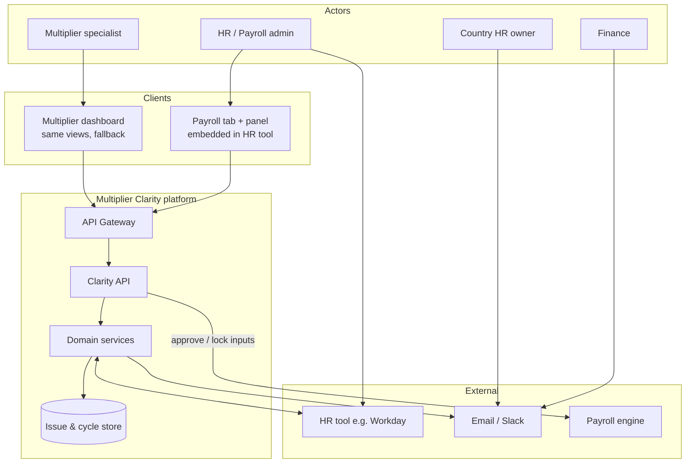
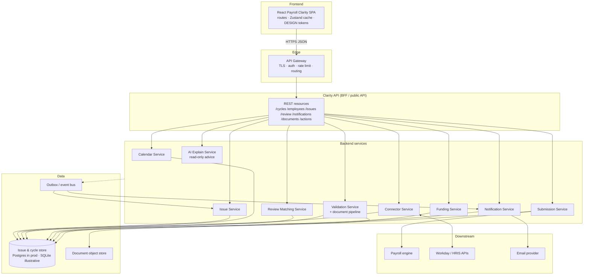
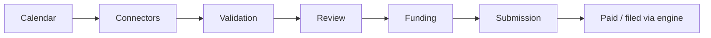
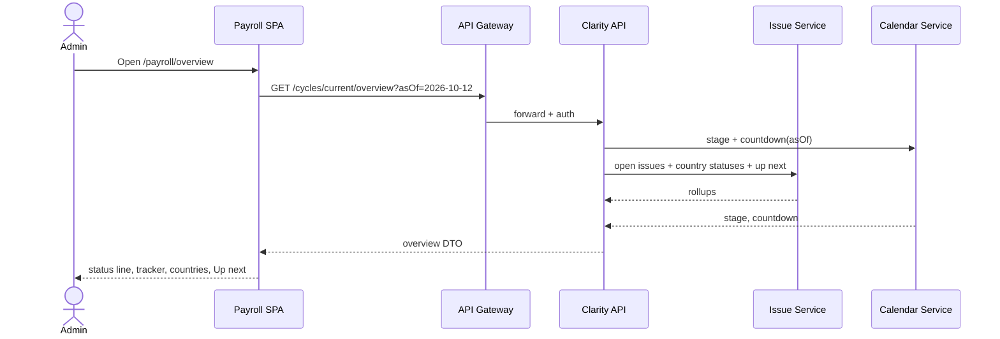
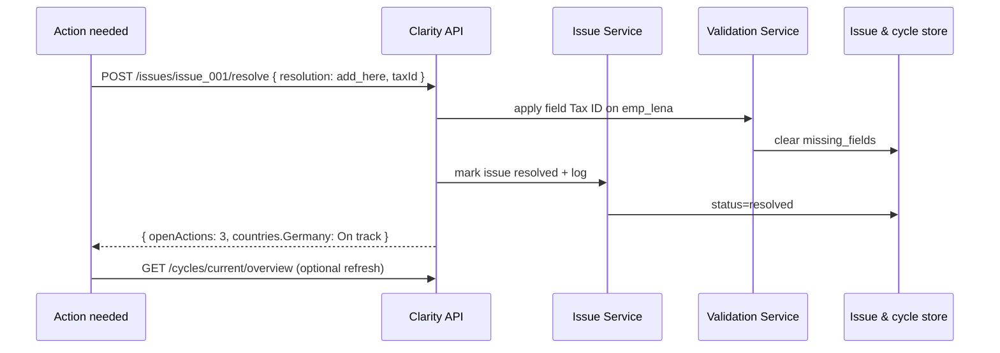
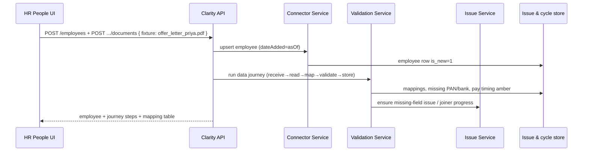
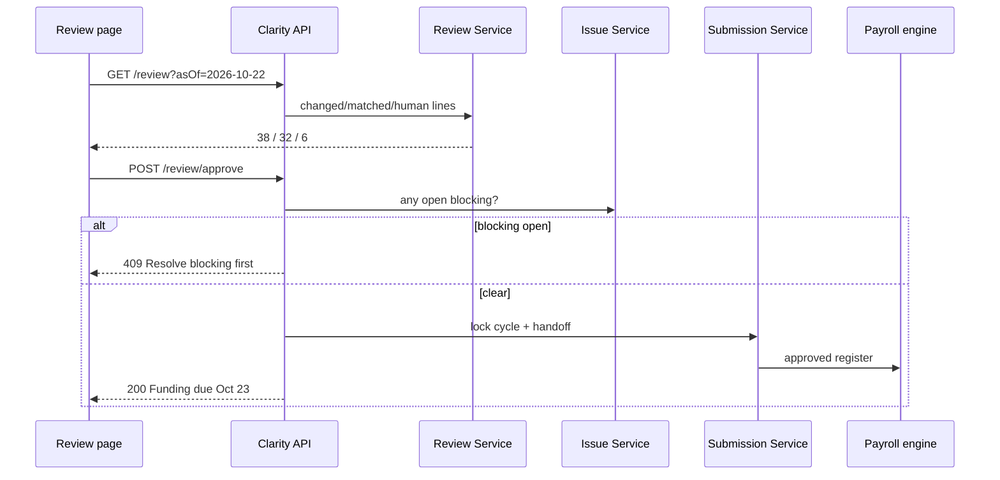
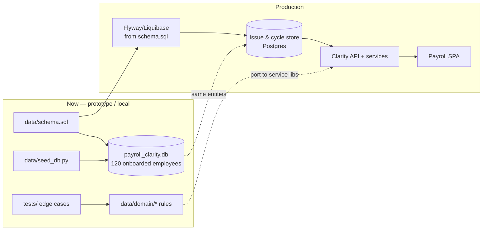
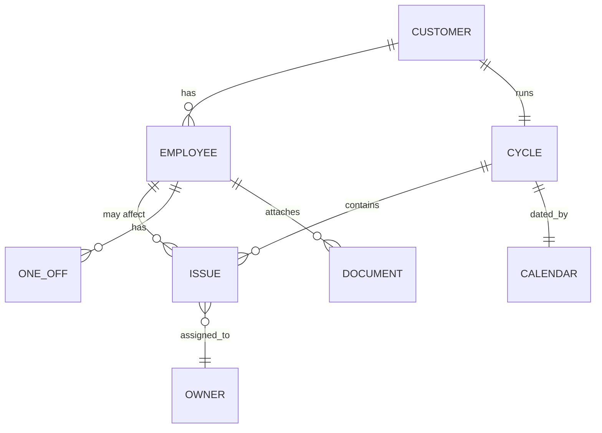
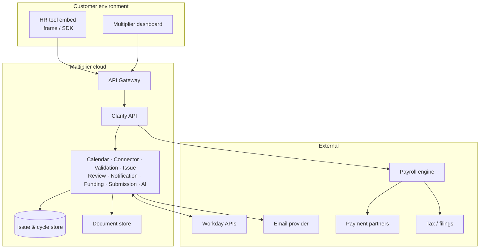

# Payroll Clarity — Service Architecture

Service architecture for Multiplier’s **Payroll Clarity** product: a Multiplier-branded Payroll tab (and employee Payroll panel) embedded in the customer’s HR tool. The frontend is a thin client; **all reads and writes go through the Clarity API** (behind an API gateway). Backend services share an **issue & cycle store** and catch problems as data arrives so each issue can be routed before input finalisation.

Sources: `Payroll_Clarity_PRD_final_touse.docx`, `context.md`, Stitch UI, `DESIGN.md`, illustrative DB in `data/`.

---

## 1. Architectural principles

| Principle | Implication |
|---|---|
| Frontend is not the source of truth | React store caches API responses; mutations call Clarity API |
| Shared issue model | Every surface (tab, panel, email) reads the same issues from the cycle store |
| Hold affected employees only | Blocking never freezes the whole payroll run |
| AI explains; engine decides pay | Document/AI services never write final pay amounts |
| Stage-aligned services | Calendar → Sync → Validation → Review → Funding → Submitted → Paid |
| HR source is not the payroll snapshot | People writes HR-owned fields to the HR tables. Multiplier reads them only through sync or a targeted refresh |
| Embed-first | Primary UI is inside the HR tool; Multiplier dashboard is the fallback |

**Design choices (PRD)**

| Decision | Choice |
|---|---|
| Primary surface | Embedded Payroll tab in HR tool |
| V1 geography | India, UK, Germany, Brazil (monthly calendar) |
| V1 clients | Desktop web only |

---

## 2. System context



---

## 3. High-level service architecture



**Request path:** Browser → API Gateway → Clarity API → one or more domain services → Issue & cycle store → JSON response.

**Async path:** Connector / Validation writes events → outbox → Notification Service / Issue Service update deadlines and inbox.

---

## 4. API Gateway

| Concern | Behaviour |
|---|---|
| Entry | Single public base URL, e.g. `https://api.multiplier.example/clarity/v1` |
| Auth | HR-tool embed JWT / session exchange, or Multiplier SSO for dashboard |
| Tenancy | `customer_id` (and optional `entity_id`) from token; never from untrusted body alone |
| Routing | `/clarity/v1/*` → Clarity API; health/metrics separate |
| Cross-cutting | TLS termination, request IDs, rate limits, CORS for embed origins |
| Errors | Problem+JSON (`type`, `title`, `status`, `detail`, `issue_id?`) |

The gateway does **not** contain payroll business rules. It authenticates, authorizes, and forwards.

---

## 5. Clarity API (frontend contract)

BFF-style public API consumed only by Clarity UIs (embedded tab, panel, dashboard). Internal services may call each other via private interfaces; the **browser never talks to Connector/Validation directly**.

### 5.1 Resource map

| Method | Path | Purpose | Primary service |
|---|---|---|---|
| `GET` | `/cycles/current` | Cycle dates, stage, countdown, country rollups | Calendar + Issue |
| `GET` | `/cycles/current/overview` | Status line, stage tracker, Up next | Issue + Calendar |
| `GET` | `/employees` | Roster (+ filters: country, action_needed) | Issue + store |
| `GET` | `/employees/{id}` | Profile fields + payroll panel state | Store + Validation |
| `POST` | `/employees` | Create joiner (from HR People flow / sync ack) | Connector + Validation |
| `POST` | `/employees/{id}/documents` | Attach offer/bonus (or confirm demo fixture) | Validation |
| `POST` | `/employees/{id}/missing-fields` | Add PAN/bank/tax ID in-app | Issue + Validation |
| `GET` | `/issues` | Open/resolved issues (`status`, `severity`) | Issue |
| `GET` | `/issues/{id}` | Issue detail + AI note + actions | Issue + AI |
| `POST` | `/issues/{id}/resolve` | Resolve / confirm / submit-country-inputs | Issue |
| `GET` | `/review` | 38/32/6 + human-check lines | Review |
| `POST` | `/review/approve` | Approve register (blocked if open blocking) | Review + Submission |
| `GET` | `/notifications` | Inbox filtered by “as of” date | Notification |
| `GET` | `/notifications/{id}` | Grouped actions + deep link | Notification |
| `GET` | `/documents/fixtures` | Prototype/demo document catalog | Validation (sim) |
| `GET` | `/meta/prototype-dates` | Allowed prototype dates (dev/demo only) | Calendar |

### 5.2 Example payloads (illustrative)

**`GET /cycles/current/overview`**

```json
{
  "customer": { "id": "cust_acme", "name": "Acme Tech", "hrTool": "Workday" },
  "cycle": {
    "id": "cycle_2026_10",
    "label": "October 2026",
    "stage": "Input finalisation",
    "inputFinalisation": "2026-10-15",
    "approval": "2026-10-22",
    "fundingDue": "2026-10-23",
    "payDate": "2026-10-28"
  },
  "asOf": "2026-10-12",
  "statusLine": {
    "openActions": 4,
    "countdown": "3 days left"
  },
  "countries": [
    { "country": "India", "employeeCount": 50, "status": "Deadline risk" },
    { "country": "UK", "employeeCount": 30, "status": "Action needed" },
    { "country": "Germany", "employeeCount": 22, "status": "Action needed" },
    { "country": "Brazil", "employeeCount": 18, "status": "Deadline risk" }
  ],
  "upNext": [
    { "kind": "issue", "issueId": "issue_001", "title": "Missing tax ID", "deadline": "2026-10-15" },
    { "kind": "reminder", "title": "Review & approve", "deadline": "2026-10-22" }
  ]
}
```

**`POST /issues/{id}/resolve`**

```json
{
  "resolution": "add_here",
  "payload": { "taxId": "DE123456789" },
  "actor": "HR admin"
}
```

→ Updates issue status, employee missing fields, country rollup; returns updated issue + overview counters.

**`POST /review/approve`**

- `409` if any `severity=blocking` and `status=open`
- `200` → `{ "approved": true, "next": { "fundingDue": "2026-10-23", "owner": "Finance" } }`

---

## 6. Backend service catalog

| Service | Responsibility | Reads / writes | Emits |
|---|---|---|---|
| **Calendar Service** | Country pay calendars; sets deadlines on issues; stage & countdown for `asOf` | Cycle dates | `deadline.approaching` |
| **Connector Service** | Pull HRIS changes, joiners, attachments; mark Received / missing entry | Employees, docs refs | `employee.received`, `document.received` |
| **Validation Service** | Document extract/map, country required fields, pay-timing flags; create/update issues | Employees, mappings, issues | `issue.created`, `employee.validated` |
| **AI Explain Service** | Plain-language notes on unusual changes; **never mutates amounts** | Issue + history | — |
| **Issue Service** | CRUD/query issues; severity routing; resolve; hold scope; overview rollups | Issues, employees | `issue.resolved` |
| **Review Matching Service** | Diff vs last approved; match to source; 38/32/6; human-check lines | Review lines, issues | `review.ready` |
| **Notification Service** | Group issues into emails (Slack V2); inbox API | Notifications | outbound email |
| **Funding Service** | Invoice / funds received status for finance | Cycle funding fields | `funding.due` |
| **Submission Service** | Lock inputs after approve; hand off to payroll engine | Cycle approved flag | `payroll.submitted` |

### Stage alignment



Employee / issue status set at each stage: Received → Clean/Flagged → Auto-matched/Needs check → Funding due → This run → Paid.

---

## 7. Frontend → API flows

The SPA keeps a Zustand (or Context) **cache** of the last API responses. Prototype date (`asOf`) is sent as a query param in demo mode; production uses server “today” / calendar.

### 7.1 Overview load



### 7.2 Resolve blocking issue (Lena)



### 7.3 Add joiner + document (Priya)



### 7.4 Approve payroll



### 7.5 Screen → API matrix

| UI route | Primary API calls |
|---|---|
| `/payroll/overview` | `GET /cycles/current/overview` |
| `/payroll/actions` | `GET /issues`, `GET /issues/{id}`, `POST /issues/{id}/resolve` |
| `/payroll/employees` | `GET /employees` |
| `/payroll/review` | `GET /review`, `POST /review/approve` |
| `/payroll/notifications` | `GET /notifications`, `GET /notifications/{id}` |
| `/people/add` | `POST /employees`, `POST /employees/{id}/documents` |
| `/people/:id` | `GET /employees/{id}`, `POST .../missing-fields`, `POST .../documents` |

---

## 8. Data architecture — illustrative DB → issue & cycle store

### 8.1 Role of `data/payroll_clarity.db`

The SQLite database under `data/` is the **illustrative seed and schema prototype** for the production **Issue & cycle store**. It is not a separate product database forever: production runs the same logical model on Postgres (or Multiplier’s existing store), migrated from this schema.



### 8.2 Table → service ownership

| SQLite / store table | Owning service(s) | Notes |
|---|---|---|
| `customers` | Platform / tenancy | Acme Tech · Workday |
| `payroll_cycles` | Calendar + Submission | Dates, stage, 38/32/6, `approved` |
| `employees` | Connector + Validation | 120 onboarded at seed; joiners added via API |
| `employee_missing_fields` | Validation + Issue | e.g. Lena Tax ID |
| `employee_one_offs` | Validation | James bonus £8,000 after attach |
| `issues` | **Issue Service** | Spine for all UIs |
| `cycle_reminders` | Calendar + Notification | Review / Funding “Up next” |
| `document_fixtures` + `document_field_mappings` | Validation | Demo OCR maps; prod = real extract jobs |
| `notifications` + `notification_actions` | Notification | Grouped email inbox |
| `review_lines` | Review Matching | Human-check exceptions |
| `meta` | Ops | Dataset provenance |

### 8.3 Baseline seed (Oct 12)

| Fact | Value |
|---|---|
| Customer | Acme Tech · Workday |
| Employees | **120 onboarded** — India 50, UK 30, Germany 22, Brazil 18 |
| Open issues | 4 (tax ID, salary 3×, Brazil inputs, India joiners) |
| Not in the 120 | Priya Nair, Arjun Mehta (created via document/API during demo) |
| Rebuild | `python3 data/seed_db.py` |

### 8.4 How the SPA uses the store

| Mode | Behaviour |
|---|---|
| **Prototype (recommended path)** | Local/mock Clarity API reads SQLite (or JSON dump); SPA calls HTTP only |
| **Prototype (shortcut)** | SPA loads DB/JSON into Zustand once; still structured as if API-backed |
| **Production** | Clarity API ↔ Postgres issue & cycle store; SPA unchanged aside from auth |

Session rule: user resolutions persist in API/store for the session (or durable in prod); changing `asOf` recalculates derived stage/countdown/inbox without wiping resolutions.

---

## 9. Shared issue model (domain)



**Severity → routing**

| Severity | Hold scope | Owner | Channel |
|---|---|---|---|
| `blocking` | Named employee only | HR admin | In-app + email |
| `deadline_risk` | Country / cohort | Country HR or HR admin | Email + countdown |
| `needs_confirmation` | Named change | HR admin | In-app + AI note |
| `next_cycle` | Row flag | HR admin | Employee flag + off-cycle stub |

**Rules:** one owner per issue; emails group issues; tab shows one line per issue; AI never changes a number; every confirmation is logged.

---

## 10. Core domain flows (services)

### 10.1 Data journey (Validation)

Receive (Connector) → Read document → Map fields → Validate country rules + cutoff → Store in cycle → Issue Service flags gaps → Panel reads `GET /employees/{id}`.

**Pay timing:** `dateAdded` vs Oct 15 + missing fields → green / amber / red (off-cycle stub if after cutoff). Implemented in `data/domain/pay_timing.py` and mirrored in Validation Service.

### 10.2 Exception-first review

Full register → diff → match sources → auto-matched vs needs human check → Approve via Clarity API only if no open blocking issues → Submission → engine.

### 10.3 Notifications

Calendar deadlines + open issues → Notification Service groups into one email → inbox via API → CTA opens Overview (deep link). Slack = V2.

---

## 11. Frontend surfaces (API consumers)

Desktop 1440px. HR shell neutral; Payroll pages Multiplier-branded. Routes are **views over Clarity API**, not owners of business data.

| Route | Stitch screen | APIs |
|---|---|---|
| `/payroll/overview` | `payroll_overview` | overview |
| `/payroll/actions` | `payroll_action_needed` | issues + resolve |
| `/payroll/employees` | `payroll_employees` | employees |
| `/payroll/review` | `payroll_review_approve` | review + approve |
| `/payroll/notifications` | `payroll_notifications` | notifications |
| `/people/add` | `hr_tool_people_add_employee` | employees + documents |
| `/people/:id` | `hr_tool_people_priya_nair` | employee + journey |

Greyed stubs (AI assistant V2, Finance/Calendar V3, Slack V2) stay client-side until their APIs exist.

**UI stack:** React, TypeScript, Vite, Tailwind (`DESIGN.md`), React Router, Zustand cache, `lucide-react`.

---

## 12. Deployment view



---

## 13. Prototype vs production

| Layer | Prototype | Production |
|---|---|---|
| Clients | Same SPA routes | Same + real embed auth |
| API | Mock Clarity API or thin Node/Python over SQLite | Gateway + Clarity API |
| Services | In-process fakes / fixed fixtures | Independently deployable services |
| Store | `data/payroll_clarity.db` | Postgres issue & cycle store |
| Connectors / OCR / email | Fixed results from fixtures | Live HRIS, document pipeline, ESP |
| Auth | None / demo header | Embed JWT + SSO |
| `asOf` date | Prototype date dropdown | Calendar “today” (+ support time-travel in non-prod) |

Edge-case rules are locked in `tests/` + `data/domain/` and must hold in service implementations.

---

## 14. Versioned capability map

| Version | Backend / API | UI |
|---|---|---|
| **V1** | Calendar, Connector, Validation, Issue, Review, Notification (email), Submission; Clarity API as above | Payroll tab + panel |
| **V2** | Slack channel; write-back to HRIS; AI assistant endpoints | Mobile; Slack tab; assistant nav |
| **V3** | Finance & calendar projection APIs; guided-fix workflows | Finance view; calendar view; guided steps |

---

## 15. Sync, snapshot, and funding

People writes HR-owned changes to `hr_employees`. `employees` is the Multiplier snapshot. `sync_runs` and `sync_changes` record each full sync. `funding_snapshots` stores the first-sync baseline and the final estimate.

`server/services/sync.py` compares the HR source with the snapshot, applies only changes received on or before the configured input deadline, and then reuses the existing salary, review, and issue services. Later changes are stored as Next cycle and are not included in the current run. The final sync (`trigger = Final`) is idempotent. A failed attempt rolls back and does not move `last successful sync`.

Funding (`server/services/funding.py`) is gross pay plus the configured employer contribution, converted into the company funding currency. Fees are out of scope. Variance against the baseline splits into forex, employer-rate changes, and other (headcount and compensation) without overlap. Rates in config are illustrative.

Field ownership stays in `config/rules.json`. Payroll-owned corrections write the payroll record and revalidate immediately. HR-owned corrections wait for sync or `POST /api/sync/refresh`.

## 16. Source map

| Source | Contribution |
|---|---|
| PRD | Problem, users, stage services, routing, metrics |
| `context.md` | Demo data, routes, exact copy/rules |
| Stitch / `DESIGN.md` | UI surfaces and tokens |
| `data/schema.sql` + seed | Physical model for issue & cycle store |
| `data/domain` + `tests/` | Executable business rules |

Illustrative customer: **Acme Tech** · 120 employees · Workday · October 2026 cycle.
