# Payroll Clarity — Implementation Plan

Phase-wise plan aligned with the **service architecture** in `architecture.md`: thin frontend → API Gateway → Clarity API → domain services → **issue & cycle store**. Product copy, demo data, and UX still follow `context.md` and the Stitch UI.

**Goal:** Walk the Oct 2026 Acme Tech demo end-to-end on desktop (1440px). The SPA is not the source of truth; it caches Clarity API responses and sends all mutations over HTTP.

**Prototype stack**

| Layer | Choice |
|---|---|
| Store | `data/payroll_clarity.db` (SQLite) = illustrative issue & cycle store |
| Domain rules | `data/domain/*` (ported into services; mirrored in FE only for display helpers if needed) |
| Backend | Local Clarity API (Flask, `server/`) + in-process service modules over SQLite |
| Gateway | Thin middleware on the same process (request ID, demo auth header, CORS) |
| Frontend | React + TypeScript + Vite · Tailwind (`DESIGN.md`) · React Router · Zustand **cache** · `lucide-react` |

**Sources of truth:** `architecture.md` (services, APIs, FE→API flows) · `context.md` (names, amounts, demo script) · Stitch HTML · `DESIGN.md` · `tests/EDGE_CASES.md`.

---

## Phase map

```mermaid
flowchart LR
    PD["Phase Data<br/>Issue & cycle store"] --> PT["Phase Test<br/>Domain edge cases"]
    PT --> PAPI["Phase API<br/>Gateway + Clarity API + services"]
    PAPI --> P0["Phase 0<br/>FE scaffold & tokens"]
    P0 --> P1["Phase 1<br/>Shell · API client · cache"]
    P1 --> P2["Phase 2<br/>Overview + Actions"]
    P2 --> P3["Phase 3<br/>Employees"]
    P3 --> P4["Phase 4<br/>People + data journey"]
    P4 --> P5["Phase 5<br/>Review & approve"]
    P5 --> P6["Phase 6<br/>Notifications"]
    P6 --> P7["Phase 7<br/>Stubs · polish · demo"]
    P7 --> PT2["Phase Test UI<br/>Vitest / Playwright"]
```



| Phase | Delivers | Unlocks |
|---|---|---|
| **Data** | SQLite issue & cycle store (120 onboarded employees + fixtures) | Durable seed for API |
| **Test** | pytest edge suite on domain + seed | Rule lock before API/UI |
| **API** | Gateway + Clarity API + service modules over SQLite | FE can stay thin |
| 0 | FE boots with design tokens **(done)** | UI composition |
| 1 | Shell, routes, API client, Zustand cache, `asOf` control **(done)** | Every screen |
| 2 | Overview + Action needed via issues/overview APIs **(done)** | Core “what’s due / fix it” story |
| 3 | Employees via `GET /employees` **(done)** | Joiners / flags |
| 4 | People + journey via employees/documents APIs **(done)** | Demo scenes 4–6 |
| 5 | Review + approve APIs **(done)** | Approve gate |
| 6 | Notifications APIs **(done)** | Reminder-first story |
| 7 | V2/V3 stubs + DESIGN polish **(done)** | Interview-ready demo |
| **Test UI** | Component + E2E against running API + SPA | Demo-safe release |

**Out of scope for prototype:** real HRIS connectors, real OCR, real email send, production SSO, payroll engine G2N, escrow, FX, dual-control, Philippines / 5th country, mobile. **In scope:** illustrative store, mock Clarity API, in-process services with fixed connector/document/email results.

**Hard rule:** Browser never imports SQLite or service modules directly. FE → `fetch`/`apiClient` → Gateway → Clarity API only.

---

## Phase Data — Issue & cycle store (done)

**Objective:** Physical model for the production issue & cycle store (`architecture.md` §8). Maps `data/schema.sql` → services’ tables.

**Location:** `data/` · see `data/README.md`

| Artifact | Architecture role |
|---|---|
| `data/schema.sql` | Store schema (customers, cycles, employees, issues, docs, notifications, review) |
| `data/seed_db.py` | Deterministic seed (RNG 42) |
| `data/payroll_clarity.db` | Local issue & cycle store |
| `data/domain/*` | Rules later owned by Calendar / Validation / Issue / Notification services |

**Baseline (Oct 12):** Acme Tech · Workday · **120 onboarded** (IN 50 / UK 30 / DE 22 / BR 18) · 4 open issues · 3 document fixtures · 5 emails · review 38/32/6. Priya / Arjun are **not** in the 120.

**Rebuild:** `python3 data/seed_db.py`

**Exit criteria**

- [x] 120 employees; country totals exact  
- [x] Named seeds and issues match `context.md`  
- [x] Schema covers tables owned by Issue, Calendar, Validation, Review, Notification (`architecture.md` §8.2)

---

## Phase Test — Domain & seed edge cases (done)

**Objective:** Lock business rules before API/UI (`architecture.md` §§9–10). Catalog: `tests/EDGE_CASES.md`.

```bash
python3 -m pytest tests/ -v
```

**Exit criteria**

- [x] 134+ pytest cases green  
- [x] Pay timing, stage/countdown, issue hold scope, approve gate, notifications-by-`asOf`, demo script scenarios  

**Ongoing:** When a Clarity API handler is added, add an API-level test that hits the same rule (e.g. `POST /review/approve` → 409 while blocking open). Port `data/domain` into `server/` (or `api/`) service packages; keep pytest importing the same modules.

---

## Phase API — Gateway, Clarity API, services (done)

**Objective:** Implement the request path from `architecture.md` §§3–7 against SQLite. This is the **backend for the prototype**.

### Layout

```
server/   (or api/)
  gateway/          # CORS, request-id, demo auth, mount /clarity/v1
  clarity_api/      # route handlers = Clarity API resources
  services/
    calendar.py
    connector.py      # simulated HRIS sync / acknowledgements
    validation.py     # fixtures + pay timing + journey steps
    issue.py
    review.py
    notification.py
    funding.py        # stub status for messaging
    submission.py     # approve → approved flag (engine handoff stub)
    ai_explain.py     # read-only notes from issue.ai_note
  db/
    connection.py     # open payroll_clarity.db
    repositories.py   # SQL access
```

### Tasks

1. **Gateway**
   - Base path `/clarity/v1`
   - Demo header `X-Customer-Id: cust_acme` (stand-in for JWT tenancy)
   - CORS for Vite origin; `X-Request-Id` on every response
   - Problem+JSON errors

2. **Wire Clarity API resources** (`architecture.md` §5.1)

   | Method | Path | Service(s) |
   |---|---|---|
   | `GET` | `/cycles/current` | Calendar + Issue |
   | `GET` | `/cycles/current/overview` | Calendar + Issue |
   | `GET` | `/employees` | Issue + store |
   | `GET` | `/employees/{id}` | Validation + store |
   | `POST` | `/employees` | Connector + Validation |
   | `POST` | `/employees/{id}/documents` | Validation |
   | `POST` | `/employees/{id}/missing-fields` | Validation + Issue |
   | `GET` | `/issues` | Issue |
   | `GET` | `/issues/{id}` | Issue + AI Explain |
   | `POST` | `/issues/{id}/resolve` | Issue (+ Validation when fields applied) |
   | `GET` | `/review` | Review |
   | `POST` | `/review/approve` | Review + Issue gate + Submission |
   | `GET` | `/notifications` | Notification (`?asOf=`) |
   | `GET` | `/notifications/{id}` | Notification |
   | `GET` | `/documents/fixtures` | Validation |
   | `GET` | `/meta/prototype-dates` | Calendar |

3. **Service behaviour (prototype)**
   - **Calendar:** stage + countdown from `asOf`; cycle dates from `payroll_cycles`
   - **Connector:** `POST /employees` writes employee with `date_added=asOf`, `is_new=1` (no live Workday)
   - **Validation:** map demo fixtures; pay timing via `domain.pay_timing`; journey step timestamps fixed
   - **Issue:** sort/open/resolve; hold only named employee; overview country chips
   - **AI Explain:** return `ai_note`; never update `monthly_net`
   - **Review:** return seeded 38/32/6 + lines; approve → 409 if open blocking
   - **Notification:** filter `send_date <= asOf`, newest first; no real SMTP
   - **Submission:** set `payroll_cycles.approved=1`; log “engine handoff stub”

4. **`asOf` query param** on read APIs in demo mode (maps to prototype date control). Mutations persist in SQLite for the process lifetime (or until re-seed).

5. **Contract tests**
   - Overview Oct 12 → `openActions: 4`, countdown `3 days left`
   - Resolve Lena → Germany On track, openActions 3
   - Approve with blocking → 409; after resolve → 200 + fundingDue

### Exit criteria

- [x] `GET /clarity/v1/cycles/current/overview?asOf=2026-10-12` matches architecture sample shape  
- [x] All §5.1 routes implemented (stubs allowed only for unused V2 paths)  
- [x] Services read/write SQLite only through repositories  
- [x] API contract tests green; domain pytest still green (`tests/test_api_contracts.py`)  
- [x] Route list checked into `server/README.md`

---

## Phase 0 — Frontend scaffold & design system (done)

**Objective:** SPA shell with tokens; **no business data in FE source files**.

### Tasks

1. Vite React+TS; Tailwind; React Router; Zustand; `lucide-react`  
2. Tokens from `DESIGN.md` (context blue `#1D4ED8` if brand conflict)  
3. Folder layout:

   ```
   src/
     app/              # shell, router, providers
     api/              # clarityClient.ts — ONLY HTTP entry to backend
     features/payroll/
     features/people/
     store/            # Zustand cache of API DTOs (not seed tables)
     components/
     styles/
   ```

4. Baseline components: `StatusChip`, `Button`, `PageHeader`, `EmptyState`, `Toast`  
5. Footer: “Illustrative data”

### Exit criteria

- [x] `npm run dev` loads blank shell at 1440px  
- [x] `VITE_CLARITY_API_BASE` points at local Gateway  
- [x] No imports from `data/*.db` or `server/services` in FE code  

---

## Phase 1 — Shell, API client, cache (done)

**Objective:** App chrome + typed Clarity client + Zustand as **response cache** (`architecture.md` §§7, 11).

### Tasks

1. **Layout shell** (unchanged UX)
   - Prototype bar: date dropdown → sets `asOf` in cache and refetches  
   - Nav: Payroll children + greyed V2/V3 stubs  
   - Payroll header vs People (HR-tool) chrome  

2. **Routes** — same as before (`/payroll/*`, `/people/*`)

3. **`clarityClient`**
   - Wrappers for every Phase API route  
   - Pass `asOf` on GETs; send JSON bodies on POSTs  
   - Map Problem+JSON to toasts  

4. **Zustand cache**
   - State: `asOf`, `overview`, `issues`, `employees`, `review`, `notifications`, `selectedIssueId`, `toasts`  
   - Actions call API then patch cache (or invalidate + refetch)  
   - `setAsOf(date)` → refetch overview, issues, employees, notifications, review  

5. **Boot**
   - `GET /meta/prototype-dates` + `GET /cycles/current/overview`  
   - Nav badge from `overview.statusLine.openActions` (or `GET /issues?status=open`)

### Screen → API (must hold for all later phases)

| Route | APIs |
|---|---|
| `/payroll/overview` | `GET /cycles/current/overview` |
| `/payroll/actions` | `GET /issues`, `GET /issues/{id}`, `POST /issues/{id}/resolve` |
| `/payroll/employees` | `GET /employees` |
| `/payroll/review` | `GET /review`, `POST /review/approve` |
| `/payroll/notifications` | `GET /notifications`, `GET /notifications/{id}` |
| `/people/add` | `POST /employees`, `POST /employees/{id}/documents` |
| `/people/:id` | `GET /employees/{id}`, `POST .../missing-fields`, `POST .../documents` |

### Exit criteria

- [x] All routes reachable (placeholders OK)  
- [x] Changing prototype date refetches with new `asOf`  
- [x] Badge reflects API open-issue count  
- [x] Network tab shows Clarity calls (no local seed reads)

---

## Phase 2 — Overview + Action needed (Issue Service UI) (done)

**Objective:** Issue spine via Clarity API (`architecture.md` §7.1–7.2). Demo scenes 1–3.

### 2A — Overview

Bind exclusively to `GET /cycles/current/overview`:

| Element | DTO field |
|---|---|
| Status line | `statusLine.openActions` + `countdown` + cycle finalisation date |
| Stage tracker | `cycle.stage` (+ stage order constant) |
| Country rows | `countries[]` |
| Up next | `upNext[]` → link `/payroll/actions?issue={issueId}` |

No decorative stat tiles.

### 2B — Action needed

- List: `GET /issues?status=open` (server returns severity sort)  
- Detail: `GET /issues/{id}` (includes `aiNote`, impact, actions)  
- Resolve:

  | Issue | UI | API |
  |---|---|---|
  | Lena tax ID | Add here instead | `POST /issues/issue_001/resolve` `{ resolution: "add_here", payload: { taxId } }` |
  | Lena | Fix in Workday | Client stub toast (no API) |
  | James 3× | Yes, correct | `POST .../resolve` `{ resolution: "confirm" }` |
  | James | Correct amount | Client stub |
  | Brazil | Submit inputs | `POST .../resolve` `{ resolution: "submit_country_inputs" }` |
  | India joiners | Link to `/people/add` | Resolved when joiners created (Phase 4) |

After resolve: refetch overview + issues (badge, chips, counts).

### Exit criteria

- [x] Oct 12 overview: 4 actions · 3 days left via API  
- [x] Fix Lena → 3 · Germany On track (API + UI)  
- [x] Confirm James → 2; confirmation reflected in issue payload/log  
- [x] AI note displayed; `monthly_net` unchanged in store  

---

## Phase 3 — Employees (`GET /employees`) (done)

**Objective:** Roster + pay-timing flags from Validation/Issue-enriched employee DTOs.

### Tasks

1. Columns per `context.md`; sort new first  
2. Flags come from API (`payTiming.level` / `message` / `showOffCycleStub`) — FE only renders  
3. Filters: call `GET /employees?country=&action_needed=` (or client filter if API returns full roster)  
4. Click new employee → `/people/:id`  
5. After Phase 4 bonus: show one-off from employee DTO  

### Exit criteria

- [x] Headcount 120 from API before joiners; country splits correct  
- [x] Action needed Yes/No matches issues  
- [x] No FE re-implementation of pay-timing beyond display  

---

## Phase 4 — People + data journey (Connector + Validation) (done)

**Objective:** `architecture.md` §7.3. Demo scenes 4–6.

### 4A — Add employee

- Form → `POST /employees` with fields + `asOf`  
- Demo file dropdown → `POST /employees/{id}/documents` `{ fixture: "offer_letter_priya.pdf" | "offer_letter_arjun.pdf" }`  
- Navigate to profile with returned id  

### 4B — Profile + Payroll panel

- `GET /employees/{id}` returns journey steps, mappings, pay timing  
- Animate steps client-side from API step list  
- **Add missing details** → `POST /employees/{id}/missing-fields`  
- **Attach bonus** (James) → `POST .../documents` `{ fixture: "bonus_letter_james.pdf" }` → Issue Service resolves `issue_002`  
- **View offer letter** → stub toast  

### Exit criteria

- [x] Priya Oct 13: journey + amber PAN/bank from API  
- [x] Fill details → green October  
- [x] James bonus → one-off £8,000; base net still 4000  
- [x] Arjun Oct 17 → November + off-cycle stub  
- [x] Priya still missing on Oct 17 → Moved to November  

---

## Phase 5 — Review & approve (done)

**Objective:** `architecture.md` §7.4.

1. `GET /review?asOf=` — empty-state copy before review window; full UI on Oct 22  
2. Show `changedLines` / `matchedLines` / `needsHumanCheck` only  
3. Table from `lines[]`  
4. `POST /review/approve` — disable button when client knows blocking open **and** handle `409` from API  
5. Success copy: Funding due Oct 23 (finance)  

### Exit criteria

- [x] 38 / 32 / 6 from API  
- [x] 409/disabled while blocking open; 200 after Lena resolved  
- [x] `payroll_cycles.approved` set in store  

---

## Phase 6 — Notifications (done)

**Objective:** Notification Service via API.

1. `GET /notifications?asOf=` — Email tab  
2. Slack tab = V2 stub (no API call)  
3. Detail: `GET /notifications/{id}` — grouped actions, single **Open Payroll tab** → Overview  
4. No per-item buttons in the email body  

### Exit criteria

- [x] Oct 12: one email, 4 actions, CTA works  
- [x] Later `asOf` reveals later emails  
- [x] Finance funding mail recipient visible on Oct 21+  

---

## Phase 7 — Stubs, polish, demo hardening (done)

Same stub matrix as product plan (AI assistant V2, write-back V2, Slack V2, Finance/Calendar V3, guided steps V3, not-built toasts).

### Demo script (API-backed)

1. Notifications → Overview (both via GET)  
2–3. Resolve Lena / James via `POST /issues/{id}/resolve`  
4–6. Employees/documents POSTs + GETs  
7. Review GET + approve POST  
8. Stubs client-only; nothing crashes  

Also verify: refresh reloads from API/store; document how to re-seed DB between demos.

### Exit criteria

- [x] Full demo green against running Gateway + SPA  
- [x] README: start store (seeded), start API, start Vite, demo date sequence  

---

## Phase Test UI (done)

**Objective:** Automate FE + API edge cases after Phase 7.

| Layer | Cases | Where |
|---|---|---|
| Vitest | `clarityClient` URL/`asOf` building; cache updates on resolve | `src/api/clarityClient.test.ts`, `src/store/store.test.ts` · `npm test` |
| Playwright | 8-step demo; stub clicks; approve disabled; badge; filters | `e2e/demo.spec.ts` · `npm run test:e2e` |
| API (pytest/httpx) | Contract tests from Phase API still in CI | `tests/test_api_contracts.py` · `python3 -m pytest tests/ -q` |

Playwright boots its own stack (API on :8788 over a freshly seeded tmp SQLite via `CLARITY_DB_PATH`/`CLARITY_PORT`, Vite on :5174) so the demo DB is never touched.

### Exit criteria

- [x] 17 Vitest cases green (client URL/headers/errors; store hydrate/resolve/asOf/attach)  
- [x] 10 Playwright cases green: Oct 22 gate preview, demo steps 1–8, Employees filters  
- [x] Found & fixed by e2e: `£8000` → `£8,000` in Employees one-off cell; prototype date now survives a page reload (`localStorage`)

---

## Cross-cutting notes

### Ownership (avoid drift)

| Rule | Lives in | FE may |
|---|---|---|
| Pay timing | Validation Service (`data/domain/pay_timing`) | Render DTO |
| Stage / countdown | Calendar Service | Render DTO |
| Issue sort / approve gate | Issue / Review services | Optimistic UI OK if API enforced |
| Email visibility | Notification Service | Render list |

### Invariants

- Resolving an issue is an API write; all surfaces refresh from API  
- Documents/joiners go through Connector + Validation endpoints  
- Changing `asOf` refetches; does not invent client-side seed rows  
- AI Explain never PATCHes compensation fields  

### Stitch → pages

| Stitch | Page | Primary APIs |
|---|---|---|
| `payroll_overview` | `OverviewPage` | overview |
| `payroll_action_needed` | `ActionsPage` | issues + resolve |
| `payroll_employees` | `EmployeesPage` | employees |
| `payroll_review_approve` | `ReviewPage` | review + approve |
| `payroll_notifications` | `NotificationsPage` | notifications |
| `hr_tool_people_add_employee` | `AddEmployeePage` | employees + documents |
| `hr_tool_people_priya_nair` | `EmployeeProfilePage` + `PayrollPanel` | employee + missing-fields + documents |

### Suggested schedule

| Day | Phase | Focus |
|---|---|---|
| 0 | Data + Test | Already done — keep pytest green |
| 1 | API | Gateway + Clarity routes + service modules + contract tests |
| 2 | 0–1 | FE scaffold, client, shell, cache |
| 3 | 2 | Overview + Actions against API |
| 4 | 3–4 | Employees + People journey |
| 5 | 5–7 + Test UI | Review, Notifications, polish, Playwright |

Critical path: **Phase API** then **Phase 2** and **Phase 4**.

---

## Production follow-on

After the prototype API shape is stable (`architecture.md` §§12–14):

1. Migrate SQLite schema → Postgres issue & cycle store  
2. Split in-process services into deployables; keep Clarity API as BFF  
3. Real API Gateway auth (embed JWT / SSO)  
4. Live Connector (Workday), document pipeline, email provider  
5. Submission → real payroll engine; Funding service live  
6. V2: Slack, write-back, AI assistant endpoints; V3: Finance/Calendar APIs  

---

## Definition of done

1. Clarity API implements `architecture.md` §5.1 against the issue & cycle store  
2. SPA uses **only** the API client for reads/writes  
3. All seven Stitch screens work for Acme Tech demo data  
4. `asOf` / prototype date drives stage, issues, flags, inbox via API  
5. Shared issue model updates every surface after resolve  
6. Demo script (8 steps) passes against API + SPA  
7. Stubs visible with version notes  
8. UI matches `DESIGN.md`  
9. `pytest tests/` + API contract tests green  

Primary references: `architecture.md` · `context.md` · Stitch · `DESIGN.md` · `data/` · `tests/EDGE_CASES.md`.
